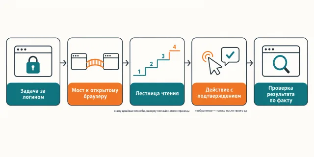

[Русский](README.md) · English

# Half of the work sits behind your login, and the agent sees exactly what is open to everyone

`jadlis-browser` is the skill for the `browser-operator` agent. The agent works in three browsers:
a Chrome profile of its own (`agent`, more profiles if you want), your Chrome through a bridge
extension when nothing else will do, and a windowless background Chrome for public pages. Its own
profile works in the background, uploads files and holds several agents at once. The skill reads a page by a ladder — from a pinpoint search over the tree up to a full
snapshot, which comes last.

```
claude plugin marketplace add https://github.com/beCyborg/jadlis-hub.git
claude plugin install jadlis-browser@jadlis
```

No keys needed. Besides the skill, the plugin carries a template of the `browser-operator` agent and
the `agent-chrome.sh` script. You put them in place once by hand: see "Installing and the first run".


In words: on the left a browser window with the logins already done, on the right the data pulled
off the page, and along the bottom the rule — take the cheapest way to see the page, not the most
vivid one.

This is my workbench published as it is, not a product: whatever I stopped using, I removed.

## Before → after

| By hand | With an AI chat | With this plugin |
|---|---|---|
| **How the agent reaches a closed page.** You copy pieces of your account page into the chat yourself. | A public address it will fetch; behind a login it sees the sign-in form. | The agent works in its own Chrome: profile `agent` is a separate Chrome instance with its own data folder. You log into the sites you need there once by hand. Your own Chrome through the bridge is the fallback. |
| **Your screen while the agent works.** Only you work at the computer. | — | In its own profiles the agent works in background windows and does not take focus. The bridge, by contrast, raises your Chrome on every connect. |
| **What it costs to see the page.** You look with your eyes — the agent sees nothing. | You paste the whole page text and pay for it in context. | The servers run with `--snapshot-mode=none`: no page snapshot arrives on its own after an action. The agent first takes data from the site's own API — a `fetch` from inside the page. Where there is no API, it climbs a ladder: tree search, a JS expression, a scoped snapshot, and a full snapshot last. |
| **What happens to screenshots.** You take them yourself and attach them. | The image goes into the thread whole and stays there. | The `--image-responses=omit` flag: a screenshot is always written to a file under `~/.claude/operator-runs/playwright-files/` and read from disk when it is genuinely needed. |
| **Passwords and keys.** You copy them through the clipboard. | It asks you to paste the password into the chat. | The password never enters the model's context. `secret-relay.py` from the separate jadlis-secrets plugin hands a secret from 1Password to one page field over a one-shot random localhost port. Without it — a "blind" clipboard: the agent puts the password on the clipboard with no output, pastes it and clears the clipboard at once. A key the site shows goes straight into Keychain or 1Password. The agent sees only the length. |
| **An irreversible action on your account.** You press it yourself and own it. | It presses nothing: it has no session of yours. | The agent acts under your logins. A purchase, send or delete not listed in the task is forbidden: the agent stops and asks. That is a rule in the prompt, not a technical block. |
| **A click that silently did nothing.** You see it on screen and repeat it. | — | After a meaningful action the effect is checked, not the return code. A slow navigation may report a timeout although the click went through — the agent checks the URL before any retry. |

## How it works



Going in — a task on a site where the agent or you are already signed in.
Inside — the choice of browser, reading from cheap to expensive, and a question before anything irreversible.
Coming out — the data pulled and the actions taken, verified by the live state rather than by a return code.

In words: task behind a login → the agent's own profile or the bridge to your Chrome → reading
ladder → action with confirmation → verification by the live state.

The three browsers:

| | the agent's profile `agent` | your Chrome | background Chrome |
|---|---|---|---|
| What lives there | sites you signed into in that profile | a site you are signed into only on your side | your own landings and public JS pages |
| Connection | Patchright MCP over CDP port 127.0.0.1:9333 | Playwright MCP through the bridge extension | `playwright-cli`, no window |
| Lifetime | started on demand; optionally `idle-stop` from launchd or cron stops it after 30 min without clients | kept open by you | a session closes itself after 1 h idle |
| Focus | stays with you | Chrome is raised on every connect | no window |
| File upload | works | does not work | works |
| Parallel | yes | one client across all sessions | yes, named sessions |

The agent's profiles are separate Chrome instances, each with its own user-data-dir under
`~/Library/Application Support/Jadlis Agent Chrome/<profile>`; they never touch your Chrome. Profiles
and ports live in `~/.config/jadlis/agent-chrome.conf`, by default one line `agent=9333`. They are
controlled by
`~/.claude/scripts/agent-chrome.sh {ensure|status|stop|window|open|idle-stop} [profile]`.
`ensure` starts Chrome without taking the focus: no window comes forward, the previous tabs come back
in background windows. It also heals discarded and crashed tabs: those hang `@playwright/mcp` on
connect, Patchright does not hang.

The `pw-agent` and `pw` servers are declared inline in the agent file
`~/.claude/agents/browser-operator.md`, so they start only while that agent runs. The agent's
profiles run Patchright MCP from the `patchright-core` package: the same tools as Playwright MCP, but
three CDP-leak detectors do not see it. The bridge `pw` runs `@playwright/mcp`. The versions are
pinned in one place — the top of `scripts/setup.mjs`. All servers share the flags
`--snapshot-mode=none`, `--console-level=error`,
`--image-responses=omit`; the bridge adds `--extension`. The consequences show up immediately: after
a click or a navigation the agent is blind until it asks for a read itself; no base64 screenshot arrives.

Every tool call is a model turn, so the skill saves turns. Network first: the agent finds the site's
API and calls it with a `fetch` from inside the page. A known flow goes into one
`browser_run_code_unsafe` script instead of ten calls. Then direct URLs instead of menus, and
extracting data with code. The reading ladder, cheapest first: `browser_find` — grep over the
accessibility tree; `browser_evaluate` — a JS function that returns only the computed value; a scoped
snapshot by `target` and `depth`; a full snapshot for an unfamiliar structure; a screenshot only for
visual questions.

Several agents can work at once. In different profiles there are no limits. In one profile each
agent opens its own background window and works in it only through `browser_run_code_unsafe`.

The bridge trap has its own section in the skill: a fully occluded window of your Chrome is frozen by
macOS, so clicks hang while reading keeps working. The cure is raising the window by its process pid
with `osascript`. In the agent's profiles clicks and typing work in a covered window too.

## Installing and the first run

**a) Text to paste to the agent.** Copy it whole into a Claude Code chat:

```
You are the installer. Put the jadlis-browser plugin from the jadlis marketplace on this Mac.
Run exactly these commands, verbatim, abbreviating nothing:
1. claude plugin marketplace add https://github.com/beCyborg/jadlis-hub.git
2. claude plugin install jadlis-browser@jadlis
3. claude plugin list — show me the jadlis-browser line and its version.
4. Find the plugin folder: claude plugin list --json, the installPath field of jadlis-browser.
   Below, P is that folder.
5. node "$P/scripts/setup.mjs" --dry-run — show me which files it would change
   (if ~/.claude/agents/browser-operator.md already exists, ask me whether to replace it).
6. node "$P/scripts/setup.mjs" — show me the output: ok, version and installed must match.
Then tell me: restart Claude Code, run ~/.claude/scripts/agent-chrome.sh open and sign
into the sites I need in the window that opens.
The fallback through my own Chrome needs the extension token in the
PLAYWRIGHT_MCP_EXTENSION_TOKEN variable. Never print the token value: check only whether it is set.
Before each command show it to me in full and wait for a yes. If I say no, do not run it,
tell me what you skipped and move on.
If a command returns an error — stop, show the output, do not go on to the next one.
```

**b) The commands by hand.**

```
claude plugin marketplace add https://github.com/beCyborg/jadlis-hub.git
claude plugin install jadlis-browser@jadlis
claude plugin list
```

The first command installs nothing — it adds the marketplace. Only the second installs, and it is
removed by one line: `claude plugin uninstall jadlis-browser@jadlis --keep-data`.

Next come the agent and the Chrome profile. The plugin carries them as files; one command puts them
in place. `$P` is the plugin folder: `claude plugin list --json` shows it in the `installPath` field.

```
node "$P/scripts/setup.mjs"
```

It copies the scripts to `~/.claude/scripts/`, renders the agent `~/.claude/agents/browser-operator.md`
with one `pw-<name>` block per profile, loads the `com.jadlis.agent-chrome` job and prints the version
that is now installed. A replaced file stays next to it as `<name>.bak-<timestamp>`.
`~/.config/jadlis/agent-chrome.conf` holds one profile by default, `agent=9333`. Need another
profile — add a `name=port` line and run setup again. A `name=port app=Google Chrome Beta` line runs the profile
in another app, so the agent's windows never mix with your Chrome; moving an existing profile is described in
`skills/browser/references/gotchas.md`. `BROWSER_PROFILE` in the shared
`~/.config/jadlis/agent.conf` sets the default profile. There `BROWSER_KEEPALIVE="<name>"` keeps a
profile always running, and `BROWSER_AUTO_SETUP="yes"` repeats setup after every plugin update. Optional CAPTCHA solver:
`BROWSER_CAPTCHA_EXT="<profiles>"` where a solver extension with a key is installed, `BROWSER_CAPTCHA_API="<command>"`
for an API solver script; without them the operator reports a CAPTCHA as BLOCKED at once. Restart
Claude Code and open the profile window: `~/.claude/scripts/agent-chrome.sh open`. Sign into the
sites you need in that window once. For passwords install the jadlis-secrets plugin: it provides
`secret-relay.py` and `op-agent.sh`.

**c) The short command.** Open Claude Code and type:

```
/browser
```

Not found — check the name with `claude plugin list`. The skill also triggers on a plain sentence:
"in my browser open the orders page and pull the statuses".

**The extension in Chrome — for the fallback only.** Install [Playwright Extension](https://chromewebstore.google.com/detail/playwright-extension/mmlmfjhmonkocbjadbfplnigmagldckm)
from the Chrome Web Store (Chrome, Edge or Chromium), version 0.3.0 or newer — the bridge no longer
speaks the old protocol. Without a token the extension asks you to confirm a tab on the first connect.
The token from the extension's status page removes that dialog. The plugin no longer asks for it:
put it into the `PLAYWRIGHT_MCP_EXTENSION_TOKEN` environment variable, for example in `~/.zshenv`.

**Ads and cookie banners — optional.** `node "$P/scripts/setup.mjs" --adblock` puts two extensions
into the agent's profiles. One is uBlock Origin Lite from the official release; setup checks its
sha256. The other answers cookie banners with a refusal; it is built from DuckDuckGo's autoconsent
library. The profile lines get `ext=`, and `agent-chrome.sh` loads both extensions at every start.
Without the flag setup installs neither. When a site breaks, the operator lowers the blocking on that
site only and says so in its report. Sites without the cookie refusal —
`~/.config/jadlis/adblock-skip-hosts.txt`.

**The check.** "show me the browser tabs" → the reply lists the open tabs.

## Limits, cost, updating

**What it does not do.** It does not replace an ordinary scraper: a public page is cheaper to fetch
that way, and what belongs here is whatever lives behind a login. Through the bridge it does not upload
files: in extension mode the browser blocks the privileged file-setting command. In the agent's
profiles upload works. It does not open `file://`. The bridge takes only one client at a time across
all sessions. It does not block irreversible actions technically — it asks, but the keys to your
account in its hands are yours. Arbitrary JS inside the server process (`browser_run_code_unsafe`)
runs only code the agent wrote for the task, never code taken from a page.

**What you need.** No keys and no subscriptions. You need Chrome, `npm` and `npx` in the system: `npm`
installs the Patchright runtime, `npx` starts the bridge. You need Node.js 22 or newer. The agent `~/.claude/agents/browser-operator.md` and the script
`~/.claude/scripts/agent-chrome.sh` come from the plugin through the steps in "Installing and the
first run". For the fallback — the
Playwright MCP Bridge extension 0.3.0 or newer and, optionally, the token in
`PLAYWRIGHT_MCP_EXTENSION_TOKEN`. The application Claude Code is started from needs Full Disk Access:
without it the bridge cannot enumerate the Chrome extensions folder and reports "Extension not found"
while the extension is installed.

**How tokens get spent.** A run costs turns times context. That is why the skill shrank from 25 KB
to ~8 KB: it holds only what the model cannot see from inside, plus the techniques that save turns. A
full snapshot of an unfamiliar structure and screenshots cost more than the rest, which is why both
sit at the bottom of the ladder.

**Verified where I work:** my Mac, my Chrome. The `@playwright/mcp@0.0.80` and bridge-extension pair
was run through the `skills/browser/TESTS.md` matrix on 2026-09-01; the pin moved to 0.0.83 on
2026-09-30. The agent's profiles went through the same matrix on 2026-10-07. Since 3.1.0 the pin is 0.0.84:
it closes tabs that crashed before the CDP connect. Since 4.0.0 the agent's profiles run Patchright
MCP 1.64.3: on 2026-11-10 it went through the matrix, CAPTCHAs and detectors, results in `TESTS.md`.
Verified on macOS only; about other
systems I have nothing to say.

**Terms of use.** There is no license: all rights reserved by the author. You may read it and use it
personally. Commercial use, republishing and bundling it into your own products — by arrangement
with me.

**Updating.** With a third-party marketplace, auto-update is off on your side: until you run the
first command you keep the version you installed.

```
claude plugin marketplace update jadlis
claude plugin update jadlis-browser@jadlis
claude plugin list
```

The scripts and the agent live outside the plugin, so after an update run `node "$P/scripts/setup.mjs"`
(or turn on `BROWSER_AUTO_SETUP="yes"` — then the first new session does it).

**From 3.x to 4.0.0.** After the update setup changes three things:
1. It installs the Patchright runtime into `~/.local/share/jadlis-browser/patchright-<version>/`. That
   needs npm; if it fails, the profiles stay on `@playwright/mcp` and setup says why.
2. It renders the agent file again: the profile servers now start `node` with Patchright. Hand edits
   in that file are lost; the previous file stays next to it as `browser-operator.md.bak-<time>`.
3. It puts `agent-ext.mjs` into `~/.claude/scripts/`.

Setup leaves the profile configs alone; only `--adblock` adds `ext=`. Recipes in the operator's memory
that read page globals through `browser_evaluate` need the main-world call — the skill's «Driver»
section has it.

Rollback: put `BROWSER_DRIVER="playwright"` into `~/.config/jadlis/agent.conf` and run setup again.
The profiles go back to `@playwright/mcp`. For the whole previous agent file, copy its `.bak` back.

A reinstall, if something landed wrong:

```
claude plugin uninstall jadlis-browser@jadlis --keep-data && claude plugin install jadlis-browser@jadlis
```

Version history — [CHANGELOG.md](CHANGELOG.md).
