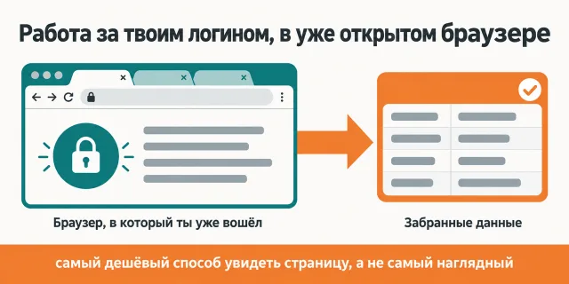
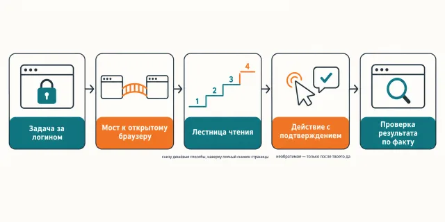

Русский · [English](README.en.md)

# Половина работы лежит за твоим логином, а агент видит ровно то, что открыто всем

`jadlis-browser` — скилл для агента `browser-operator`. Агент работает в трёх браузерах:
в своём профиле Chrome (`agent`, по желанию — ещё профили), в твоём Chrome через расширение-мост,
если иначе нельзя, и в фоновом Chrome без окна для публичных страниц. Свой профиль работает в фоне,
грузит файлы и держит несколько агентов сразу. Страницу скилл
читает по лестнице — от точечного поиска по дереву до полного снимка последним.

```
claude plugin marketplace add https://github.com/beCyborg/jadlis-hub.git
claude plugin install jadlis-browser@jadlis
```

Ключей не нужно. Кроме скилла плагин несёт шаблон агента `browser-operator` и скрипт
`agent-chrome.sh`. Их ставишь один раз руками: как — в разделе «Установка и первый запуск».



Текстом: слева окно браузера с уже пройденными логинами, справа забранные со страницы данные,
внизу общее правило — брать самый дешёвый способ увидеть страницу, а не самый наглядный.

Это моё рабочее место, выложенное как есть, а не продукт: чем перестал пользоваться — убрал.

## Было → стало

| Руками | Чатом с ИИ | Этим плагином |
|---|---|---|
| **Как агент попадает на закрытую страницу.** Копируешь куски личного кабинета в чат сам. | Публичный адрес скачает, а за логином увидит форму входа. | Агент работает в своём Chrome: профиль `agent` — отдельный экземпляр Chrome со своей папкой данных. В нём ты один раз входишь руками в нужные сайты. Твой Chrome через мост — запасной путь. |
| **Твой экран, пока агент работает.** Работаешь за компьютером только ты. | — | В своих профилях агент работает в фоновых окнах и не забирает фокус. Мост, наоборот, поднимает твой Chrome при каждом подключении. |
| **Сколько стоит увидеть страницу.** Смотришь глазами — агенту не видно ничего. | Вставляешь текст страницы целиком и платишь за него контекстом. | Серверы подняты с `--snapshot-mode=none`: снимок страницы после действия сам не приходит. Данные агент сперва берёт из API самого сайта — `fetch` изнутри страницы. Где API нет, идёт по лестнице: поиск по дереву, JS-выражение, снимок поддерева, полный снимок последним. |
| **Что происходит со скриншотами.** Делаешь сам и прикладываешь. | Картинка уезжает в переписку целиком и остаётся в ней. | Флаг `--image-responses=omit`: скриншот всегда пишется файлом в `~/.claude/operator-runs/playwright-files/` и читается с диска, когда действительно нужен. |
| **Пароли и ключи.** Копируешь через буфер обмена. | Просит вставить пароль в чат. | Пароль не попадает в контекст модели. Скрипт `secret-relay.py` из отдельного плагина jadlis-secrets отдаёт секрет из 1Password в одно поле страницы через одноразовый случайный порт на localhost. Без него — «слепой» буфер обмена: агент кладёт пароль в буфер без вывода, вставляет и сразу очищает буфер. Ключ, который показал сайт, уходит прямо в Связку ключей или 1Password. Агент видит только длину. |
| **Необратимое действие на твоём аккаунте.** Жмёшь сам и отвечаешь за это сам. | Не жмёт ничего: твоей сессии у него нет. | Агент действует под твоими логинами. Покупка, отправка или удаление, которых нет в задаче, запрещены: агент останавливается и спрашивает. Это правило в промпте, а не техническая блокировка. |
| **Тихо не сработавший клик.** Видишь на экране и повторяешь. | — | После значимого действия проверяется эффект, а не код возврата. Медленный переход может вернуть таймаут, хотя клик прошёл, — агент сперва проверяет адрес и только потом повторяет. |

## Как это работает



На входе — задача на сайте, где агент или ты уже вошли.
Внутри — выбор браузера, чтение от дешёвого к дорогому и вопрос перед необратимым.
На выходе — забранные данные и выполненные действия, проверенные по факту, а не по коду возврата.

Текстом: задача за логином → свой профиль агента или мост к твоему Chrome → лестница чтения →
действие с подтверждением → проверка результата по факту.

Три браузера:

| | профиль агента `agent` | твой Chrome | фоновый Chrome |
|---|---|---|---|
| Что там | сайты, в которые ты вошёл в этом профиле | сайт, где ты вошёл только у себя | свои лендинги и публичные страницы с JS |
| Подключение | Playwright MCP по CDP-порту 127.0.0.1:9333 | Playwright MCP через расширение-мост | `playwright-cli`, без окна |
| Жизнь | стартует по запросу; по желанию `idle-stop` из launchd или cron гасит его после 30 минут без клиентов | держишь открытым ты | сессия закрывается сама после часа простоя |
| Фокус | остаётся у тебя | Chrome поднимается при каждом подключении | окна нет |
| Загрузка файлов | работает | не работает | работает |
| Параллельно | да | один клиент на все сессии | да, именованные сессии |

Профили агента — отдельные экземпляры Chrome со своей папкой данных в
`~/Library/Application Support/Jadlis Agent Chrome/<профиль>`; твой Chrome они не трогают. Список
профилей и портов — в `~/.config/jadlis/agent-chrome.conf`, по умолчанию одна строка `agent=9333`.
Управляет ими скрипт
`~/.claude/scripts/agent-chrome.sh {ensure|status|stop|window|open|idle-stop} [профиль]`.
`ensure` запускает Chrome и заодно лечит выгруженные и упавшие вкладки: на них `@playwright/mcp`
0.0.83 зависает при подключении.

Серверы `pw-agent` и `pw` объявлены прямо в агенте `~/.claude/agents/browser-operator.md`.
Поэтому они стартуют только на время работы агента. Пин у всех один — `@playwright/mcp@0.0.83`, флаги
`--snapshot-mode=none`, `--console-level=error`, `--image-responses=omit`; у моста ещё `--extension`.
Следствия видны сразу: после клика и навигации агент «слеп», пока сам не позовёт чтение; base64
скриншота не приходит.

Каждый вызов инструмента — это ход модели, поэтому скилл экономит ходы. Сперва сеть: агент находит
API сайта и зовёт его через `fetch` изнутри страницы. Известный сценарий идёт одним скриптом
`browser_run_code_unsafe`, а не десятью вызовами. Дальше прямые адреса вместо меню и извлечение
данных кодом. Лестница чтения снизу вверх по цене: `browser_find` — grep по дереву доступности;
`browser_evaluate` — JS-функция, возвращающая только вычисленное значение; снимок поддерева по `target`
и `depth`; полный снимок — для незнакомой структуры; скриншот — только для визуальных вопросов.

Несколько агентов могут работать одновременно. В разных профилях ограничений нет. В одном профиле
каждый агент открывает своё фоновое окно и работает в нём только через `browser_run_code_unsafe`.

Ловушка моста описана в скилле отдельно: полностью перекрытое окно твоего Chrome macOS замораживает,
и клики висят, а чтение работает. Лечится поднятием окна по pid процесса через `osascript`. В профилях
агента клики и ввод работают и в перекрытом окне.

## Установка и первый запуск

**а) Текст для вставки агенту.** Скопируй целиком в чат Claude Code:

```
Ты — установщик. Поставь на этот Mac плагин jadlis-browser из маркетплейса jadlis.
Выполни ровно эти команды, дословно, ничего не сокращая:
1. claude plugin marketplace add https://github.com/beCyborg/jadlis-hub.git
2. claude plugin install jadlis-browser@jadlis
3. claude plugin list — покажи мне строку про jadlis-browser и его версию.
4. Найди папку плагина: claude plugin list --json, поле installPath у jadlis-browser.
   Дальше P — эта папка.
5. node "$P/scripts/setup.mjs" --dry-run — покажи, какие файлы он поменяет
   (если ~/.claude/agents/browser-operator.md уже есть — спроси меня, заменять ли его).
6. node "$P/scripts/setup.mjs" — покажи вывод: ok, version и installed должны совпасть.
Потом скажи мне: перезапусти Claude Code, затем запусти ~/.claude/scripts/agent-chrome.sh open
и войди в нужные сайты в открывшемся окне.
Для запасного пути через мой Chrome нужен токен расширения в переменной
PLAYWRIGHT_MCP_EXTENSION_TOKEN. Значение токена не печатай: проверяй только «есть» или «нет».
Перед каждой командой покажи её мне целиком и дождись «да». Сказал «нет» — не выполняй,
скажи, что именно пропустил, и иди дальше.
Команда вернула ошибку — остановись, покажи вывод, к следующей не переходи.
```

**б) Команды руками.**

```
claude plugin marketplace add https://github.com/beCyborg/jadlis-hub.git
claude plugin install jadlis-browser@jadlis
claude plugin list
```

Первая команда ничего не ставит — она добавляет маркетплейс. Ставит только вторая, и снимается
она одной строкой: `claude plugin uninstall jadlis-browser@jadlis --keep-data`.

Дальше — агент и профиль Chrome. Плагин несёт их файлами, на место их кладёт одна команда.
`$P` — папка плагина: её показывает `claude plugin list --json`, поле `installPath`.

```
node "$P/scripts/setup.mjs"
```

Она копирует скрипты в `~/.claude/scripts/`, собирает агента `~/.claude/agents/browser-operator.md`
с блоком `pw-<имя>` на каждый профиль, ставит службу `com.jadlis.agent-chrome` и печатает версию,
которая стоит теперь. Заменённый файл остаётся рядом как `<имя>.bak-<время>`. В
`~/.config/jadlis/agent-chrome.conf` по умолчанию один профиль `agent=9333`. Нужен ещё профиль —
добавь строку `имя=порт` и запусти setup ещё раз. Профиль по умолчанию задаёт `BROWSER_PROFILE` в
общем файле `~/.config/jadlis/agent.conf`. Там же `BROWSER_KEEPALIVE="<имя>"` держит профиль
запущенным всегда, а `BROWSER_AUTO_SETUP="yes"` сам повторяет setup после каждого обновления
плагина. Перезапусти
Claude Code и открой окно профиля: `~/.claude/scripts/agent-chrome.sh open`. В этом окне один раз
войди в нужные сайты. Для паролей поставь плагин jadlis-secrets: он даёт `secret-relay.py` и
`op-agent.sh`.

**в) Короткая команда.** Открой Claude Code и набери:

```
/browser
```

Не находится — сверь имя строкой `claude plugin list`. Скилл поднимается и на обычной фразе:
«в моём браузере открой страницу заказов и вытащи статусы».

**Расширение в Chrome — только для запасного пути.** Поставь [Playwright Extension](https://chromewebstore.google.com/detail/playwright-extension/mmlmfjhmonkocbjadbfplnigmagldckm)
из Chrome Web Store (Chrome, Edge или Chromium), версия не ниже 0.3.0 — старый протокол мост
больше не понимает. Без токена расширение при первом подключении попросит подтвердить вкладку.
Токен со страницы статуса расширения этот диалог убирает. Плагин токен больше не спрашивает:
положи его в переменную окружения `PLAYWRIGHT_MCP_EXTENSION_TOKEN`, например в `~/.zshenv`.

**Проверка.** «покажи вкладки браузера» → в ответе список открытых вкладок.

## Границы, стоимость, обновление

**Чего не делает.** Не заменяет обычный скрейпер: публичную страницу дешевле снять им, сюда идёт
то, что живёт за логином. Через мост не грузит файлы на сайт: в extension mode браузер запрещает
привилегированную команду подстановки файла. В профилях агента загрузка работает. Не открывает
`file://`. Через мост работает только один клиент за раз на все сессии. Не блокирует необратимые
действия технически — спрашивает, но клавиши от аккаунта у него твои. Произвольный JS в процессе
сервера (`browser_run_code_unsafe`) запускает только код, который агент написал под задачу, — не код
со страницы.

**Что нужно.** Ключей и подписок не нужно. Нужны Chrome и `npx` в системе — им запускаются серверы.
Нужен Node.js 22 или новее. Агент `~/.claude/agents/browser-operator.md` и скрипт
`~/.claude/scripts/agent-chrome.sh` ставятся из плагина по шагам раздела «Установка и первый
запуск». Для запасного пути — расширение Playwright MCP Bridge не ниже 0.3.0 и, по
желанию, токен в `PLAYWRIGHT_MCP_EXTENSION_TOKEN`. Приложению, из которого запущен Claude Code,
нужен Full Disk Access: без него мост не может перечислить папку расширений Chrome и сообщает
«Extension not found», хотя расширение стоит.

**Порядок расхода токенов.** Прогон стоит ходов, умноженных на контекст. Поэтому скилл ужат с 25 KB
до ~8 KB: в нём только то, чего модель не видит изнутри, и приёмы, которые экономят ходы. Дороже
прочего обходятся полный снимок незнакомой структуры и скриншоты, поэтому оба стоят в самом низу
лестницы.

**Проверено там, где я работаю:** мой Mac, мой Chrome. Связка `@playwright/mcp@0.0.80`
и расширение-мост прогнаны по тест-матрице `skills/browser/TESTS.md` 01.09.2026; пин поднят
до 0.0.83 30.09.2026. Профили агента прогнаны по той же матрице 07.10.2026. С версии 3.1.0 пин — 0.0.84:
он закрывает вкладки, упавшие до подключения по CDP. Проверено только на macOS; про другие
системы сказать нечего.

**Условия использования.** Лицензии нет: все права сохранены за автором. Читать и
пользоваться лично можно. Коммерческое использование, переиздание и включение в свои
продукты — по договорённости со мной.

**Обновление.** У стороннего маркетплейса авто-обновление на твоей стороне выключено: пока не
запустишь первую команду, у тебя остаётся та версия, которую ты поставил.

```
claude plugin marketplace update jadlis
claude plugin update jadlis-browser@jadlis
claude plugin list
```

Скрипты и агент лежат вне плагина, поэтому после обновления запусти `node "$P/scripts/setup.mjs"`
(или включи `BROWSER_AUTO_SETUP="yes"` — тогда это сделает первая новая сессия).

Переустановка, если что-то встало криво:

```
claude plugin uninstall jadlis-browser@jadlis --keep-data && claude plugin install jadlis-browser@jadlis
```

История версий — [CHANGELOG.md](CHANGELOG.md).
